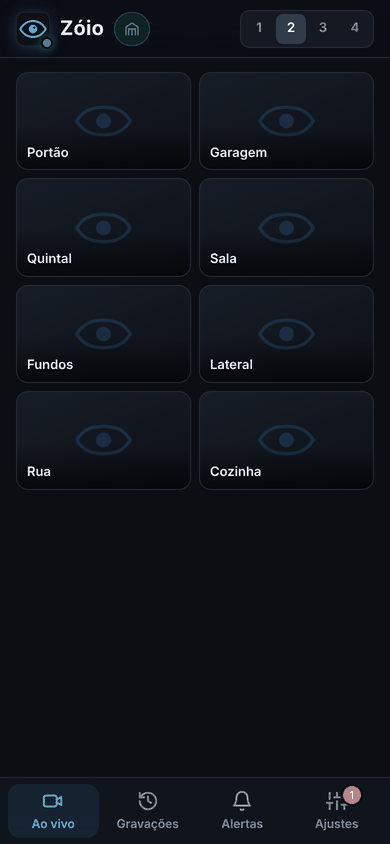
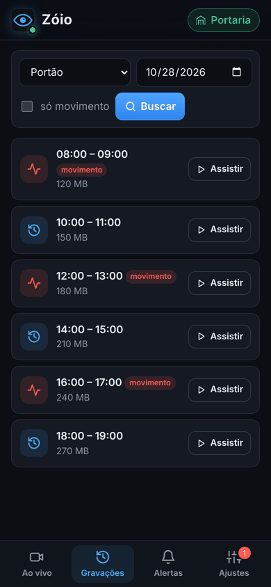
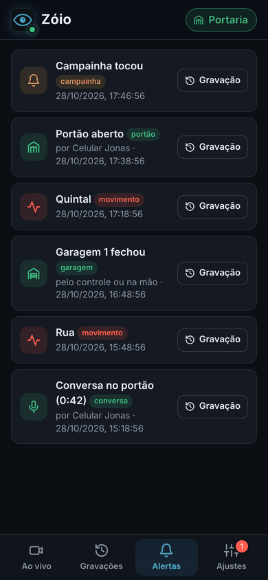
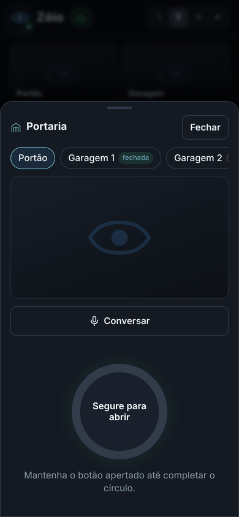
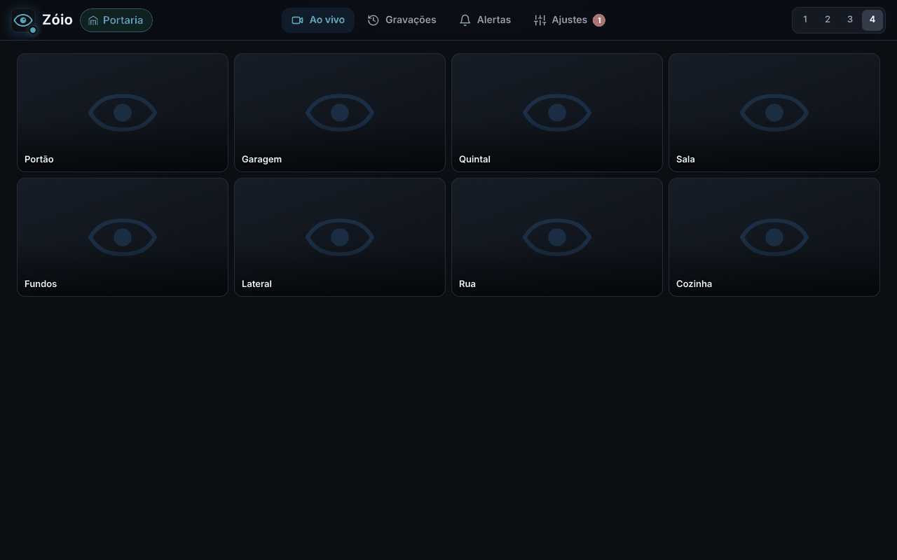
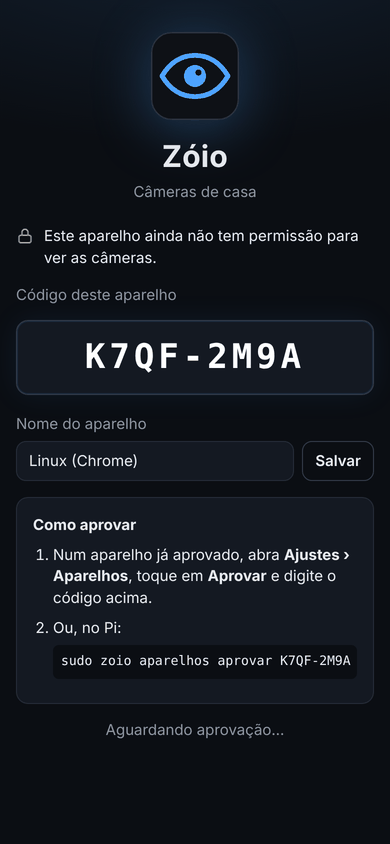
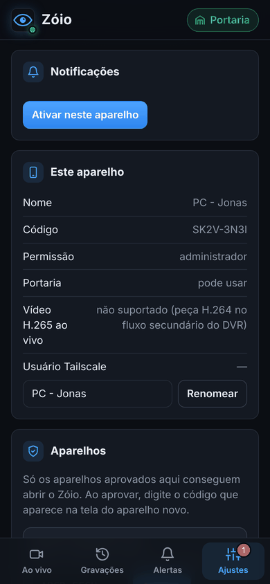
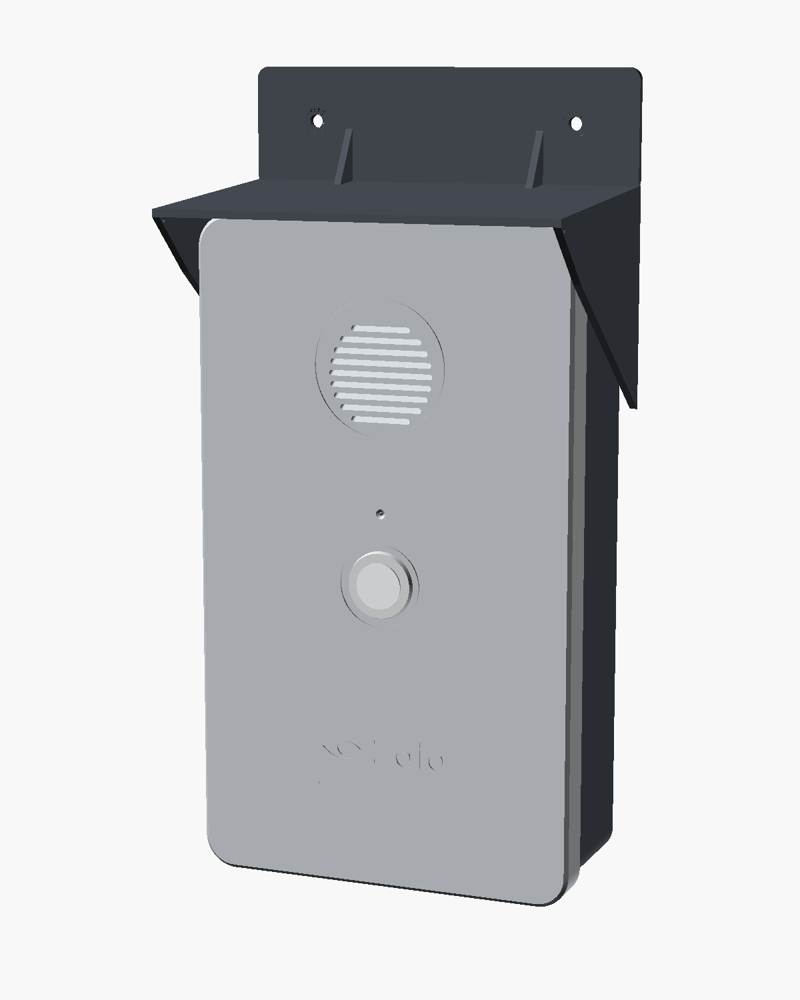
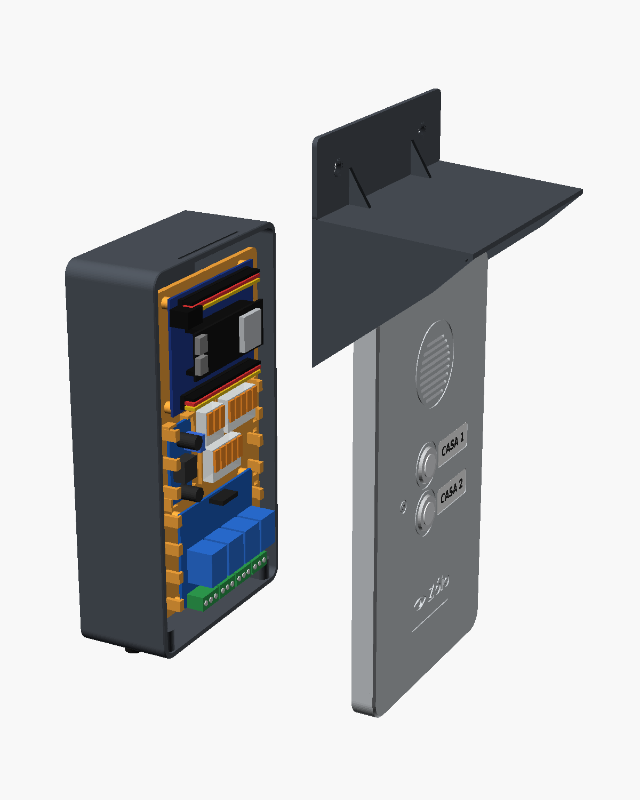

# Zóio

O Zóio é o app para olhar as câmeras de casa e cuidar do portão. Ele mostra as câmeras ao vivo em grade, toca as gravações que já estão no DVR, avisa no celular quando há movimento e, com uma plaquinha ESP32 no portão, vira porteiro: campainha no celular, conversa com quem está lá fora, abrir o portão e abrir ou fechar as garagens.

Tudo roda num Raspberry Pi 3B ao lado do DVR. Fora de casa, o acesso é só pela VPN (Tailscale) e só para aparelhos aprovados um a um. Nenhuma porta fica aberta no roteador e nada passa pela nuvem do DVR.

Funciona no Android, no iPhone, no computador e em qualquer navegador, porque é um app web instalável (PWA): basta abrir o endereço do Pi e escolher "Adicionar à tela de início".

<p align="center">
  
  
  
  
</p>

## Sumário

- [O que o Zóio faz](#o-que-o-zóio-faz)
- [Como funciona](#como-funciona)
- [O que é preciso](#o-que-é-preciso)
- [Preparar o DVR](#preparar-o-dvr)
- [Instalar no Raspberry Pi](#instalar-no-raspberry-pi)
- [Configuração (`zoio.env`)](#configuração-zoioenv)
- [Acesso de fora de casa (Tailscale)](#acesso-de-fora-de-casa-tailscale)
- [Aparelhos autorizados](#aparelhos-autorizados)
- [Usando o app](#usando-o-app)
- [Notificações](#notificações)
- [Porteiro do Zóio (portão, campainha e garagens)](#porteiro-do-zóio-portão-campainha-e-garagens)
- [Caixa do porteiro (impressão 3D)](#caixa-do-porteiro-impressão-3d)
- [Linha de comando no Pi](#linha-de-comando-no-pi)
- [Atualizar](#atualizar)
- [Problemas comuns](#problemas-comuns)
- [Segurança](#segurança)
- [Desenvolvimento](#desenvolvimento)
- [Organização do repositório](#organização-do-repositório)
- [Documentação detalhada](#documentação-detalhada)
- [Próximos passos](#próximos-passos)

## O que o Zóio faz

| Função | Como |
|---|---|
| **Ao vivo** | Grade com todas as câmeras (1 a 4 por linha) e tela cheia com a imagem principal. Borda vermelha na câmera com movimento. |
| **Gravações** | Escolhe a câmera e o dia, vê os trechos com movimento marcados, assiste no app ou baixa o MP4. Os vídeos continuam no HD do DVR. |
| **Alertas** | Histórico de 30 dias de movimento, campainha, portão e garagens, com atalho para a gravação ou foto do momento. |
| **Notificações** | Push no celular a cada movimento (com intervalo mínimo por câmera) e aviso urgente quando tocam a campainha. |
| **Aparelhos autorizados** | Cada celular ou computador precisa ser aprovado. Dá para revogar qualquer um na hora. |
| **Câmeras** | Renomear e esconder canais vazios pelo próprio app. |
| **Portaria** | Campainha no celular, conversa "segure para falar", abrir o portão e abrir, fechar ou parar as duas garagens. |

<p align="center">
  
</p>

## Como funciona

```
 celular / PC ──Tailscale (HTTPS)──► Raspberry Pi ──rede de casa──► DVR Xiongmai
                                     │                              ├─ RTSP 554 (ao vivo)
                                     ├─ tailscale serve (HTTPS)     └─ DVRIP 34567 (gravações, alarmes)
                                     ├─ zoio      (app, API, alertas, portaria)
                                     ├─ go2rtc    (ao vivo, sem recodificar)
                                     │
                                     └──Wi-Fi de casa──► ESP32-S3 no portão (ESPHome)
                                                          ├─ API cifrada 6053 (comandos, campainha, sensores)
                                                          └─ UDP cifrado 6054 (áudio, só durante a conversa)
```

- **Ao vivo.** O go2rtc pega o RTSP do DVR e entrega ao navegador por MSE/HLS, sem recodificar, porque o Pi 3B não aguentaria. A grade usa o fluxo secundário e a tela cheia usa o principal. O go2rtc só puxa do DVR o que alguém está assistindo.
- **Imagem 16:9.** O DVR manda a imagem "espremida" (352x240 no secundário, 960x1080 nos canais 1080N). O app estica para 16:9, e os MP4 baixados já saem na proporção certa (`ZOIO_VIDEO_ASPECT`).
- **Gravações.** O Zóio busca os arquivos no DVR pelo protocolo DVRIP (porta 34567), baixa o trecho escolhido e converte para MP4 com o ffmpeg, sem recodificar. Os vídeos ficam num cache no Pi com limite de espaço.
- **Alertas.** O Zóio fica inscrito nos alarmes de movimento do próprio DVR. Cada alerta aparece na hora nas telas abertas e vira uma notificação push cifrada de ponta a ponta.
- **Portaria.** O Zóio mantém uma conexão sempre aberta com a placa do portão pela API nativa do ESPHome, cifrada. Durante uma conversa, o áudio vai do celular ao Pi pelo WebSocket e do Pi à placa por UDP cifrado.
- **Banco de dados.** Aparelhos, sessões, alertas e ajustes ficam num SQLite em `/var/lib/zoio`.

Detalhes técnicos em [docs/arquitetura.md](docs/arquitetura.md).

## O que é preciso

- **DVR Xiongmai** com RTSP (porta 554) e DVRIP (porta 34567). Foi feito e testado com o AHB8004R-MH-NVT, firmware V4.03.R11, 8 canais.
- **Raspberry Pi** (3B ou mais novo) na mesma rede do DVR, com Raspberry Pi OS ou Ubuntu. O instalador usa Python 3.10 ou mais novo e as bibliotecas do apt.
- **Tailscale** no Pi e em cada aparelho que vai usar o Zóio.
- **Opcional, para a portaria:** ESP32-S3 DevKitC-1 (N16R8), relé de 4 canais, botão de campainha, microfone INMP441, amplificador MAX98357A, alto-falante, fonte 12 V e regulador para 5 V. Lista completa em [docs/porteiro.md](docs/porteiro.md#peças).

## Preparar o DVR

Antes de instalar, vale fazer estes ajustes no DVR (pelo menu dele ou pelo XMEye):

- **Fluxo secundário em H.264.** O DVR vem com tudo em H.265. Safari e Chrome com aceleração de vídeo tocam H.265, mas o Firefox e alguns aparelhos não. Com o secundário em H.264, a grade toca em qualquer lugar. Passar o principal também deixa a tela cheia universal. A gravação no HD continua como estiver.
- **Horário de verão desligado.** Senão o relógio do DVR fica 1 hora adiantado e os horários das gravações e dos alertas saem errados.
- **Detecção de movimento ligada** nas câmeras que devem gerar alertas. O Zóio usa o alarme do próprio DVR.
- **IP fixo** para o DVR e para o Pi (reserva DHCP no roteador). Faça o mesmo para a placa do porteiro, se tiver.
- **Pi no cabo de rede**, se possível. A grade com 8 câmeras passa toda pelo Pi, e o Wi-Fi fraco faz a imagem travar.
- **Senha do DVR sem `&` nem `#`**, porque ela vai dentro do endereço RTSP.

## Instalar no Raspberry Pi

1. No painel do Tailscale, em **DNS**, ative **MagicDNS** e **HTTPS Certificates**.
2. No Pi, com o Tailscale ligado:

   ```bash
   git clone https://github.com/JonasSprocatti/Z-io.git ~/zoio
   cd ~/zoio
   sudo ./deploy/install.sh
   ```

3. Na primeira vez, o Tailscale pode pedir para liberar o **Serve** na sua conta. O instalador mostra o link; depois de liberar, rode o comando que ele indica (`sudo tailscale serve --bg --https=443 http://127.0.0.1:8080`).
4. Coloque o usuário e a senha do DVR e os nomes das câmeras em `/etc/zoio/zoio.env` (veja a próxima seção) e reinicie:

   ```bash
   sudo nano /etc/zoio/zoio.env
   sudo systemctl restart zoio-go2rtc zoio
   ```

5. Teste a conexão com o DVR:

   ```bash
   sudo zoio check            # login, relógio, gravações das últimas 24 h e 15 s de alarmes
   sudo zoio check --baixar   # também baixa o começo da gravação mais recente e converte para MP4
   ```

6. Abra `https://<nome-do-pi>.<sua-rede>.ts.net` no celular e aprove o primeiro aparelho (veja [Aparelhos autorizados](#aparelhos-autorizados)).

O instalador pode rodar de novo a qualquer momento: ele não apaga a configuração nem os dados. O que ele faz:

1. instala ffmpeg e as dependências pelo apt;
2. cria o usuário de serviço `zoio`, o `/etc/zoio/zoio.env` (a partir de [`deploy/zoio.env.example`](deploy/zoio.env.example)) e o `/var/lib/zoio`;
3. baixa o go2rtc para a arquitetura do Pi;
4. instala o atalho `sudo zoio ...` e liga os serviços `zoio` e `zoio-go2rtc` no systemd;
5. publica o app com `tailscale serve`, só para a sua rede Tailscale.

Se existir `~/.zoio-dvr.env` com `DVR_USER` e `DVR_PASS`, o instalador copia o usuário e a senha de lá.

## Configuração (`zoio.env`)

Fica em `/etc/zoio/zoio.env`, legível só pelo serviço. Depois de mudar, rode `sudo systemctl restart zoio-go2rtc zoio`. O exemplo comentado está em [`deploy/zoio.env.example`](deploy/zoio.env.example).

| Variável | Para quê | Padrão |
|---|---|---|
| `DVR_HOST`, `DVR_USER`, `DVR_PASS` | Endereço e login do DVR | |
| `DVR_PORT`, `DVR_RTSP_PORT` | Portas do DVRIP e do RTSP | `34567`, `554` |
| `ZOIO_CHANNELS` | Quantos canais o DVR tem | `8` |
| `ZOIO_CHANNEL_NAMES` | Nomes das câmeras, na ordem, separados por vírgula | `Câmera 1,...` |
| `ZOIO_HIDE_CHANNELS` | Canais que nunca existem para o Zóio, ex.: `7,8` | |
| `ZOIO_DEVICE_APPROVAL` | Aprovação de aparelhos (deixe ligado) | `1` |
| `ZOIO_SESSION_DAYS` | Dias que uma sessão vale sem uso | `30` |
| `ZOIO_ALLOWED_USERS` | Só estes logins do Tailscale entram, ex.: `fulano@github` | qualquer um da sua rede |
| `ZOIO_ALERTS` | Liga os alertas de movimento | `1` |
| `ZOIO_NOTIFY_CHANNELS` | Só estas câmeras notificam, ex.: `1,2` | todas |
| `ZOIO_NOTIFY_COOLDOWN` | Segundos entre duas notificações da mesma câmera | `300` |
| `ZOIO_VIDEO_ASPECT` | Proporção da imagem; `original` mostra como o DVR manda | `16:9` |
| `ZOIO_CACHE_MAX_MB` | Espaço máximo dos vídeos baixados (os mais antigos saem primeiro) | `2048` |
| `ZOIO_PUSH_CONTACT` | Contato enviado aos serviços de push | `mailto:zoio@localhost` |
| `ZOIO_LISTEN`, `ZOIO_DATA_DIR` | Endereço do servidor e pasta de dados | `127.0.0.1:8080`, `/var/lib/zoio` |
| `ZOIO_GATE_*`, `ZOIO_GARAGE_*`, `ZOIO_BELL_NAMES` | Portaria, veja [Configurar no Zóio](#3-configurar-no-zóio) | |

Os nomes e as câmeras ocultas também mudam pelo app, em **Ajustes › Câmeras**, e o que for feito lá vale por cima do `zoio.env`.

## Acesso de fora de casa (Tailscale)

O Zóio só escuta no `127.0.0.1` do Pi. O único caminho até ele é o `tailscale serve`, que publica `https://<nome-do-pi>.<sua-rede>.ts.net` com certificado válido (necessário para o app instalável e para as notificações) e só para aparelhos da sua rede Tailscale.

Para usar fora de casa:

1. Instale o Tailscale no celular ou no computador e entre com a mesma conta do Pi (ou compartilhe o Pi com outra conta pelo painel do Tailscale).
2. Com o Tailscale ligado, abra o endereço do Pi.
3. Aprove o aparelho no Zóio.

Para limitar a pessoas específicas da sua rede Tailscale, use `ZOIO_ALLOWED_USERS`. As alternativas ao Tailscale (WireGuard próprio no Pi e Headscale), com prós, contras e como checar CGNAT, estão em [docs/acesso-remoto.md](docs/acesso-remoto.md). A decisão entre elas fica para o futuro; hoje o padrão é o Tailscale.

## Aparelhos autorizados

Estar na rede Tailscale não basta: cada aparelho precisa ser aprovado.

<p align="center">
  
  
</p>

1. Abra o Zóio no aparelho. Ele cria uma chave própria (ECDSA P-256, não exportável, guardada pelo navegador) e mostra um **código**, como `K7Q2-M9XD`.
2. **Primeiro aparelho:** aprove no Pi com `sudo zoio aparelhos aprovar K7Q2-M9XD`. Ele vira administrador.
3. **Os próximos:** num aparelho administrador, abra **Ajustes › Aparelhos** e digite o código que aparece na tela do aparelho novo. Os administradores recebem um aviso quando alguém pede acesso.
4. Ao aprovar, escolha o que o aparelho pode fazer: **aprovar outros aparelhos** (administrador) e **usar a portaria** (portão, garagens e campainha). Marque só nos aparelhos de confiança.
5. Para tirar o acesso, use **Revogar** no app ou `sudo zoio aparelhos revogar CÓDIGO`. A sessão cai na hora e as notificações daquele aparelho param.

Bom saber:

- Depois de aprovado, o aparelho entra sozinho: ele assina um desafio com a chave dele e recebe uma sessão que vale `ZOIO_SESSION_DAYS` dias sem uso.
- No iPhone, o Safari e o app da Tela de Início guardam dados separados e contam como dois aparelhos. Aprove o da Tela de Início.
- Limpar os dados do site, ou usar janela anônima, apaga a chave. Aí o aparelho precisa ser aprovado de novo.
- O último administrador não pode ser revogado pelo app, para ninguém ficar trancado para fora. Pelo Pi, sempre pode.
- Um aparelho revogado só pode pedir acesso de novo depois de `sudo zoio aparelhos excluir CÓDIGO`.

## Usando o app

O app tem quatro abas embaixo e, nos aparelhos com permissão, o botão **Portaria** no topo.

- **Ao vivo:** toque numa câmera para abrir em tela cheia no fluxo principal. O botão de tela cheia ocupa a tela toda (no celular deitado, a imagem preenche a largura). Os botões 1 a 4 no topo mudam quantas câmeras aparecem por linha. Uma borda vermelha indica movimento naquele momento.
- **Gravações:** escolha a câmera e o dia. Os trechos com movimento aparecem marcados. **Assistir** baixa o trecho do DVR (a cerca de 1 MB/s) e toca no app, com a barra de progresso. Também dá para baixar o MP4.
- **Alertas:** histórico dos últimos 30 dias. Movimento leva à gravação; campainha, portão, garagens e conversas mostram quem fez e a foto do momento.
- **Ajustes:**
  - **Notificações:** ativa neste aparelho, escolhe quais câmeras avisam e manda uma notificação de teste.
  - **Câmeras** (administradores): renomeia cada câmera e esconde canais sem câmera. Vale para todos os aparelhos na hora. Uma câmera oculta some do ao vivo, das gravações e dos alertas, e não notifica; **Mostrar** traz de volta. Apagar o nome volta ao do `zoio.env`.
  - **Este aparelho:** os dados deste aparelho e o nome com que ele aparece para os outros.
  - **Aparelhos** (administradores): aprova, revoga, libera ou bloqueia a portaria e escolhe de qual casa cada aparelho recebe a campainha.
  - **Servidor:** versão, situação do ao vivo, dos alertas do DVR e da placa do porteiro, o Wi-Fi do porteiro e, para administradores, o botão **Testar placa do porteiro**.

## Notificações

- Ative em **Ajustes › Notificações** em cada aparelho.
- **iPhone:** primeiro adicione o Zóio à Tela de Início (iOS 16.4 ou mais novo) e ative as notificações abrindo pelo ícone.
- **Android:** use o Chrome. As notificações usam o serviço de push do Google, então o Google Play Services precisa poder usar dados em segundo plano, sem restrição de bateria. Se aparecer "Registration failed - push service error", confira isso e se um VPN ou bloqueador de anúncios não está barrando o Google (`mtalk.google.com`). O app tenta de novo sozinho e explica o erro.
- O conteúdo das notificações vai cifrado de ponta a ponta (Web Push, RFC 8291). O serviço da Apple ou do Google só entrega, e o Pi só faz conexões de saída.
- Movimento respeita o intervalo de `ZOIO_NOTIFY_COOLDOWN` por câmera. A campainha é urgente: vibra, fica na tela até ser tocada e abre a portaria já no portão.

## Porteiro do Zóio (portão, campainha e garagens)

Uma placa ESP32-S3 com ESPHome no portão faz o papel de porteiro, toda pelo Wi-Fi de casa e sem nuvem. Sem a placa configurada, nada disso aparece no app. O guia completo, com ligação, segurança e o protocolo, está em [docs/porteiro.md](docs/porteiro.md).

### O que ele faz

- **Campainha:** quem tem a permissão de portaria recebe uma notificação urgente ("Tocaram no portão às 14:32") que abre a câmera do portão ao vivo. No portão, o alto-falante toca um "blim-blom" curto, para a pessoa saber que funcionou (`volume_toque` no `porteiro.yaml`).
- **Duas casas:** um segundo botão de campainha é opcional. Cada aparelho recebe só a campainha da sua casa, ou de todas (em **Ajustes › Aparelhos**), e os nomes vêm de `ZOIO_BELL_NAMES`.
- **Conversa:** no estilo rádio, **segure para falar** e solte para ouvir. Uma pessoa por vez: os outros veem quem está conversando. Acaba sozinha em 10 minutos ou se a conexão cair.
- **Abrir o portão:** segure o botão até completar o círculo.
- **Garagens:** mostram se estão abertas ou fechadas pelo sensor. **Abrir** com a garagem fechada; **Fechar** só com o vídeo daquela garagem tocando na tela; **Parar** durante o movimento.
- **Botão de saída:** um botão do lado de dentro abre o portão na hora, mesmo com o Pi ou o Wi-Fi fora do ar. Cada abertura fica registrada em Alertas.
- **Registro:** cada toque, comando e garagem que abriu ou fechou pelo controle remoto fica em Alertas, com quem fez e uma foto da câmera daquela porta.

### 1. Peças e ligação

Peças, opções de garagem (fio até a central, controle extra ou rádio 433 MHz; sensor com fio ou sem fio) e a tabela de pinos estão em [docs/porteiro.md](docs/porteiro.md#ligação). Em resumo, na fileira esquerda do ESP32-S3 DevKitC-1:

| ESP32-S3 | Vai em |
|---|---|
| GPIO4, GPIO5, GPIO6 | microfone INMP441 (SCK, WS, SD) |
| GPIO7, GPIO15, GPIO16 | amplificador MAX98357A (BCLK, LRC, DIN) |
| GPIO17 | campainha (casa 1) |
| GPIO18 | campainha da casa 2, se houver |
| GPIO21 | botão de saída, se houver |
| GPIO10 | relé 1: fechadura do portão |
| GPIO11, GPIO12 | relés 2 e 3: garagens 1 e 2 |
| GPIO13, GPIO14 | sensores magnéticos das garagens |
| GPIO8, GPIO9 | receptor e transmissor 433 MHz, na opção rádio |

Os botões e sensores ligam entre o pino e o GND. O microfone vai no 3V3; relé, amplificador e transmissor no 5V.

### 2. Gravar o firmware na placa

O firmware é o [`deploy/esphome/porteiro.yaml`](deploy/esphome/porteiro.yaml) (ESPHome 2026.10.1, ESP-IDF), com os pacotes de [`deploy/esphome/porteiro/`](deploy/esphome/porteiro) e o componente da conversa em [`deploy/esphome/components/zoio_conversa/`](deploy/esphome/components/zoio_conversa). O GitHub compila as duas variantes (com fio e com rádio) a cada mudança, com segredos de mentira.

A placa não tem atualização pela rede (OTA), página web nem ponto de acesso. Para gravar ou regravar, ela vai no USB de um computador de casa ou do Pi.

1. Gere a chave da API (no Pi): `zoio portao chave`. Guarde a saída: ela vai na placa e no `zoio.env`.
2. Crie o `deploy/esphome/secrets.yaml` só no computador que vai gravar (ele está no `.gitignore`):

   ```yaml
   wifi_ssid: "nome-da-rede"
   wifi_password: "..."
   api_key: "<saída do zoio portao chave>"
   ```

   Na opção rádio, ele também leva os códigos do controle e dos sensores (veja [Aprender os códigos do rádio](docs/porteiro.md#aprender-os-códigos-do-rádio)).
3. Escolha os pacotes de garagem e sensor no fim do `porteiro.yaml` (`packages:`). O padrão é relé e sensor com fio.
4. Instale o ESPHome num ambiente separado (ele pede Python 3.12) e grave. No Windows, por exemplo:

   ```bat
   py -3.12 -m venv C:\esphome
   C:\esphome\Scripts\pip install esphome==2026.10.1
   cd C:\zoio\deploy\esphome
   C:\esphome\Scripts\esphome run porteiro.yaml --device COM6
   ```

   No Linux ou no Pi é igual, com `python3.12 -m venv ~/esphome` e `--device /dev/ttyACM0` (ou `ttyUSB0`). A primeira compilação demora; as próximas são rápidas.
5. No ESP32-S3 de dois USB-C, grave pela entrada marcada **COM**. O log do ESPHome sai pela outra entrada (USB nativa); na COM ele para em `entry 0x...`, e isso é normal.
6. Reserve um IP fixo para a placa no roteador. O nome dela na rede é `zoio-porteiro` (no Pi, `getent hosts zoio-porteiro.local` mostra o IP atual).

### 3. Configurar no Zóio

No `/etc/zoio/zoio.env`:

| Variável | Para quê |
|---|---|
| `ZOIO_GATE_HOST` | IP da placa na rede de casa |
| `ZOIO_GATE_KEY` | chave da API (a mesma do `secrets.yaml`) |
| `ZOIO_GATE_CAMERA` | câmera do portão: ao vivo na portaria e foto da campainha e de cada abertura |
| `ZOIO_GARAGE_CAMERAS` | câmeras das garagens, na ordem (ex.: `2,3`). Sem câmera, a garagem não fecha pelo app |
| `ZOIO_GARAGE_NAMES` | nomes das garagens no app (padrão `Garagem 1,Garagem 2`) |
| `ZOIO_BELL_NAMES` | nomes das casas, na ordem das campainhas (padrão `Casa 1,Casa 2`) |
| `ZOIO_GARAGE_TRAVEL` | segundos que o motor leva para abrir ou fechar; é quanto tempo o Parar fica na tela (padrão 30) |
| `ZOIO_GATE_PORT`, `ZOIO_GATE_AUDIO_PORT`, `ZOIO_GATE_NAME` | porta da API (6053), porta do áudio (6054) e nome esperado da placa (`zoio-porteiro`) |

Depois:

```bash
sudo systemctl restart zoio
sudo zoio portao testar               # conecta e lista portas, sensores e campainhas, sem acionar nada
sudo zoio portao abrir                # abre o portão de verdade (registrado como "Pi")
sudo zoio portao acionar garagem_1    # um pulso na botoeira da garagem 1
sudo zoio aparelhos portao CÓDIGO     # libera a portaria para um aparelho (--nao bloqueia)
```

A portaria só funciona com a aprovação de aparelhos ligada, e cada comando exige uma assinatura nova do aparelho, presa à porta e à ação. Um cookie roubado não abre nada.

## Caixa do porteiro (impressão 3D)

<p align="center">
  
  
</p>

Uma caixa de porteiro para imprimir, com lugar para a placa de extensão com o ESP32, o relé, o regulador, os conectores, o amplificador, o alto-falante, o microfone, os 2 botões de campainha e o rádio opcional. Tem 127 × 217 × 57 mm, 5 peças (base, tampa, bandeja removível, anel do alto-falante e aba de chuva), prensa-cabos por baixo e vedação com espuma. Imprima em **PETG ou ASA**, nunca PLA, porque o sol amolece.

O modelo é paramétrico em OpenSCAD ([`porteiro_caixa.scad`](hardware/caixa-porteiro/porteiro_caixa.scad)), e os STLs prontos ficam em [`hardware/caixa-porteiro/stl/`](hardware/caixa-porteiro/stl). Como imprimir, o que comprar, montagem passo a passo e as medidas a conferir antes (algumas placas foram supostas) estão em [hardware/caixa-porteiro/README.md](hardware/caixa-porteiro/README.md).

## Linha de comando no Pi

O atalho `sudo zoio` roda os comandos como o usuário do serviço:

| Comando | O que faz |
|---|---|
| `sudo zoio check [--baixar]` | Testa login, relógio, gravações e alarmes do DVR (e um download curto) |
| `sudo zoio aparelhos` | Lista os aparelhos, com quem é administrador e quem tem portaria |
| `sudo zoio aparelhos aprovar CÓDIGO [--comum]` | Aprova um aparelho; `--comum` aprova sem administrador nem portaria |
| `sudo zoio aparelhos revogar CÓDIGO` | Tira o acesso na hora |
| `sudo zoio aparelhos excluir CÓDIGO` | Apaga um aparelho revogado, para ele poder pedir de novo |
| `sudo zoio aparelhos portao CÓDIGO [--nao]` | Libera ou bloqueia a portaria |
| `zoio portao chave` | Gera uma chave nova para a placa do porteiro |
| `sudo zoio portao testar` | Conecta na placa e lista o que ela tem, sem acionar nada |
| `sudo zoio portao abrir` | Abre o portão |
| `sudo zoio portao acionar garagem_N` | Um pulso na botoeira da garagem |
| `sudo zoio portao radio [--segundos N]` | Mostra os códigos de 433 MHz que a placa escuta |

Os serviços são `zoio` e `zoio-go2rtc`:

```bash
systemctl status zoio zoio-go2rtc
journalctl -u zoio -f          # log do Zóio ao vivo
```

## Atualizar

```bash
cd ~/zoio
git pull
sudo ./deploy/install.sh
```

O app nos aparelhos se atualiza sozinho na próxima vez que for aberto. A versão aparece em **Ajustes › Servidor**. O firmware da placa só muda quando você grava de novo pelo USB.

## Problemas comuns

| Sintoma | O que fazer |
|---|---|
| Câmera não toca num navegador e toca em outro | O fluxo está em H.265 e esse navegador não toca. Passe o fluxo para H.264 no DVR. |
| Horários das gravações e alertas 1 hora errados | Desligue o horário de verão no DVR. |
| Imagem travando com várias câmeras | Wi-Fi fraco no Pi. Use cabo, ou menos câmeras por linha. |
| `sudo zoio check` não conecta | Confira `DVR_HOST`, usuário e senha no `zoio.env` e se o Pi está na mesma rede do DVR. |
| Notificação não ativa no Android | Veja [Notificações](#notificações) (Play Services, VPN, bloqueador). |
| Notificação não aparece no iPhone | Abra pelo ícone da Tela de Início e ative de lá (iOS 16.4+). |
| Aparelho pede aprovação de novo | Os dados do site foram apagados ou é outra "instalação" (Safari × Tela de Início). Aprove de novo. |
| "A placa do porteiro está desconectada" | Veja se o IP mudou: `getent hosts zoio-porteiro.local` no Pi. Reserve o IP no roteador e acerte `ZOIO_GATE_HOST`. |
| "A placa recusou a chave" | `ZOIO_GATE_KEY` diferente do `api_key` do `secrets.yaml` gravado. |
| Conversa picotando | Wi-Fi fraco no portão (veja em **Ajustes › Servidor**; bom a partir de -65 dBm). Vale um repetidor perto do portão. |
| Voz baixa ou estourada | Ajuste `ganho_microfone` no topo do `porteiro.yaml` e grave de novo. |

## Segurança

- **Nada exposto na internet.** Os serviços só escutam no `127.0.0.1`. O caminho de fora é a VPN, e a interface de administração do go2rtc nunca fica acessível.
- **Duas travas.** Estar na rede Tailscale e usar um aparelho aprovado. A portaria pede ainda a permissão do aparelho e uma assinatura nova a cada comando.
- **Chaves que não saem do aparelho.** A chave privada é não exportável: nem o próprio app consegue ler.
- **Placa fechada.** Só a API nativa do ESPHome, cifrada com chave de 32 bytes. Sem página web, sem OTA e sem ponto de acesso. A conversa usa AES-128-GCM com chave nova a cada vez. Os pulsos dos relés são fixos no firmware.
- **Servidor endurecido.** Usuário próprio `zoio`, systemd com `ProtectSystem=strict`, `ProtectHome` e `NoNewPrivileges`, Content-Security-Policy restrita e bloqueio de pedidos de outros sites.
- **Senha do DVR** só em `/etc/zoio/zoio.env` e no `go2rtc.yaml` gerado em `/var/lib/zoio`, nunca no repositório.
- **Limitação conhecida:** o RTSP da Xiongmai leva a senha em texto puro na rede local (é o formato do próprio DVR).

Mais em [docs/arquitetura.md](docs/arquitetura.md#segurança) e [docs/porteiro.md](docs/porteiro.md#segurança).

## Desenvolvimento

```bash
cd server
pip install -e '.[test]'
pytest
```

Os testes não precisam de nada de verdade: usam um DVR simulado que fala DVRIP (`tests/fake_dvr.py`), uma placa ESPHome simulada (`tests/fake_esphome.py`), o lado da placa na conversa por UDP (`tests/fake_intercom.py`) e um go2rtc simulado. Eles cobrem login, busca paginada, download e conversão para MP4 (conferida com o ffprobe), alarmes, Web Push, controle de acesso, o proxy do ao vivo, a aprovação de aparelhos e a portaria inteira (criptografia da API do ESPHome, sensores, campainhas, regras das garagens, permissões, assinatura a cada comando, reconexão, conversa, registro e foto).

No GitHub rodam dois fluxos: [`testes`](.github/workflows/testes.yml) (pytest no Python 3.10 e 3.12, mais a sintaxe do instalador) e [`firmware`](.github/workflows/firmware.yml) (compila o firmware do porteiro nas variantes com fio e com rádio).

Para rodar o servidor localmente, aponte para um arquivo de configuração: `python -m zoio --env meu.env serve`.

Ao mudar o app (`server/zoio/web/`), suba a versão em `server/zoio/__init__.py` e em `server/pyproject.toml`. O CSS e o JS são servidos com `?v=<versão>`, e é isso que faz os celulares pegarem a versão nova.

O Zóio usa só `aiohttp` e `cryptography`, nas versões do apt do Pi (Python 3.10, aiohttp 3.8, cryptography 3.4). Web Push, a API do ESPHome e o DVRIP foram implementados direto, sem bibliotecas que não compilam no Pi.

## Organização do repositório

```
server/zoio/            servidor (Python, aiohttp)
  app.py                API, sessões, proxy do ao vivo
  config.py             leitura do zoio.env
  devices.py            aprovação de aparelhos
  dvrip.py, xmstream.py protocolo DVRIP e fluxo de vídeo da Xiongmai
  clips.py              busca, download e conversão das gravações
  alarms.py, push.py    alertas de movimento e Web Push
  go2rtc.py             configuração do go2rtc
  esphome.py            API nativa do ESPHome (Noise)
  porteiro.py           portaria: portas, campainhas, regras, fotos
  conversa.py           conversa com o portão (WebSocket ↔ UDP)
  store.py              SQLite
  web/                  o app (PWA): index.html, app.js, app.css, sw.js
server/tests/           testes e simuladores
deploy/                 instalador, serviços do systemd, zoio.env de exemplo
deploy/esphome/         firmware da placa do porteiro
hardware/caixa-porteiro caixa 3D (OpenSCAD e STLs)
docs/                   arquitetura, porteiro, acesso remoto e imagens
```

## Documentação detalhada

- [docs/arquitetura.md](docs/arquitetura.md): componentes, aprovação de aparelhos, segurança e uso de recursos no Pi.
- [docs/porteiro.md](docs/porteiro.md): o porteiro inteiro, de peças e ligação ao protocolo com a placa e à conversa.
- [docs/acesso-remoto.md](docs/acesso-remoto.md): Tailscale, WireGuard próprio e Headscale.
- [hardware/caixa-porteiro/README.md](hardware/caixa-porteiro/README.md): impressão e montagem da caixa.

## Próximos passos

- **Portaria no portão:** soldar o ESP32, ligar os módulos quando chegarem, definir a câmera do portão e testar campainha, fechadura e garagens com a placa de verdade.
- **Rede até o portão:** garantir Wi-Fi bom no portão (repetidor, mesh ou ligar as duas redes de casa).
- **Caixa:** conferir as medidas da placa de extensão e do relé antes de imprimir tudo.
- **App:** miniatura nos alertas de movimento e linha do tempo do dia por câmera.
- **Acesso remoto:** decidir entre continuar no Tailscale ou montar um WireGuard próprio.
