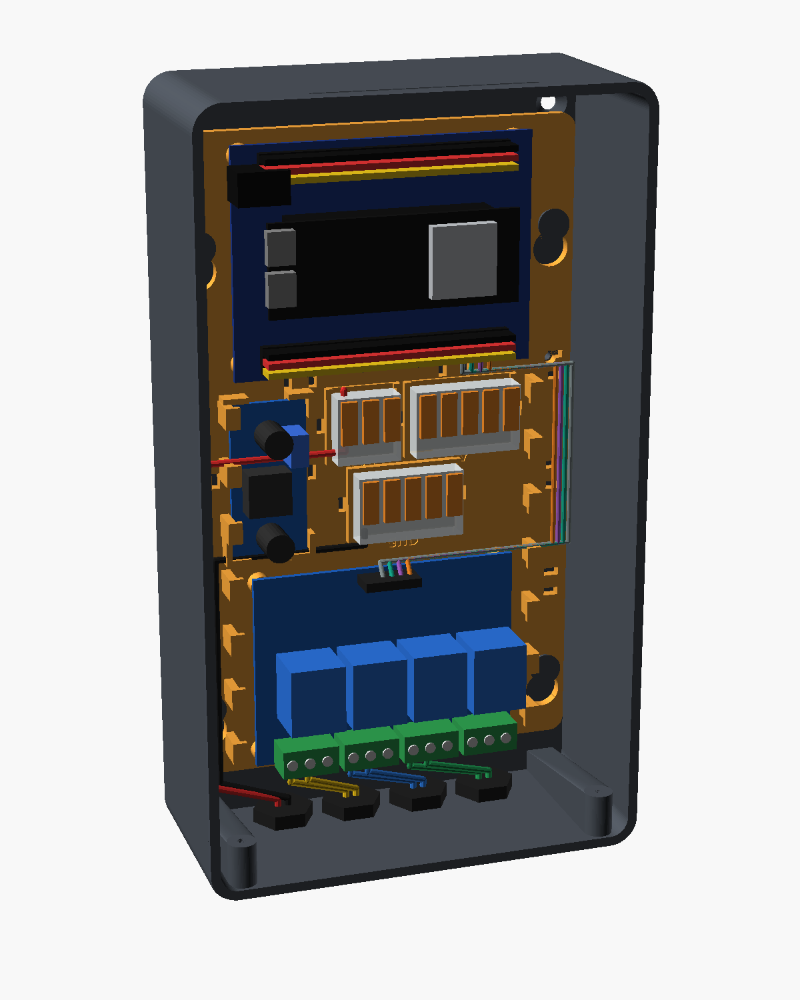
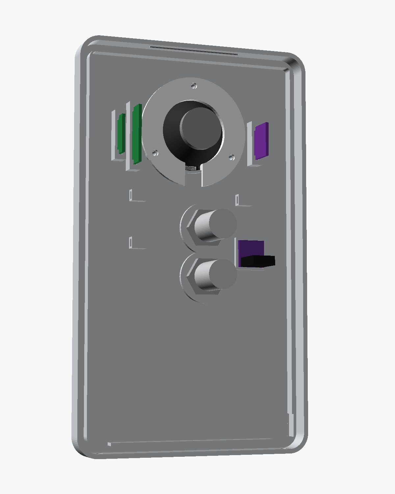
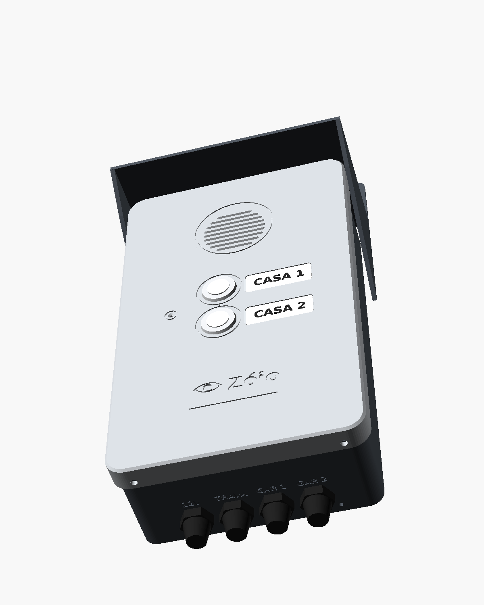

# Caixa do Porteiro do Zóio (impressão 3D)

Caixa de porteiro eletrônico para o portão, com lugar para tudo o que liga no ESP32-S3: a placa de extensão com o ESP32, o relé de 4 canais, o regulador 12 V → 5 V, os conectores Wago, o amplificador, o alto-falante, o microfone, os 2 botões de campainha (uma por casa) e o rádio 433 MHz opcional. Os cabos saem só por baixo, por prensa-cabos. Ela substitui a caixa hermética da lista de compras.


| | |
|---|---|
|  |  |
|  |  |

As placas e os fios das imagens são só ilustração. Os fios coloridos mostram por onde passam: 12 V e GND pelo canal da esquerda, os sinais do ESP32 para o relé pelo canal da direita, e a fechadura e as garagens saindo do relé direto para os prensa-cabos.

**Tamanho por fora:** 127 × 217 × 57 mm (largura × altura × profundidade), mais a aba de chuva, que fica acima.

## As 5 peças

| Arquivo | O que é | Como vai na mesa |
|---|---|---|
| [stl/base.stl](stl/base.stl) | Caixa de trás, parafusada na parede | Fundo na mesa |
| [stl/tampa.stl](stl/tampa.stl) | Frente do porteiro: grade do alto-falante, furo do microfone, 2 botões com lugar para etiqueta e o logo | Frente na mesa (o arquivo já vem virado) |
| [stl/bandeja.stl](stl/bandeja.stl) | Chassi que sai inteiro da caixa, com o encaixe de cada placa | Deitada |
| [stl/anel.stl](stl/anel.stl) | Anel que prende o alto-falante na tampa | Deitado |
| [stl/capa.stl](stl/capa.stl) | Aba contra chuva, parafusada na parede logo acima da caixa | Placa de fixação na mesa |

Nenhuma peça precisa de suporte. A tampa tem 217 mm de altura: a mesa da impressora precisa ter pelo menos 22 cm em um dos lados.

## Como imprimir

**Material: PETG ou ASA. Não use PLA**, porque ele amolece com o sol (uma caixa escura no sol passa de 60 °C).

- **ASA** é o melhor para área externa: aguenta sol por anos sem ficar quebradiço nem desbotar. Precisa de impressora fechada (ou uma caixa em volta) e cheira durante a impressão.
- **PETG** é mais fácil de imprimir e aguenta bem, ainda mais debaixo da aba. Com o tempo pode amarelar um pouco.

| Ajuste | PETG | ASA |
|---|---|---|
| Bico | 235 a 245 °C | 245 a 260 °C |
| Mesa | 75 a 85 °C | 95 a 105 °C |
| Ventoinha da peça | 30 a 50 % | 0 a 20 % |
| Brim (aba de aderência) | não precisa | 5 mm na base e na capa |

Para todas as peças:
- camada de 0,2 mm;
- **4 paredes (perímetros)** e 5 camadas em cima e embaixo, para a água não atravessar;
- preenchimento de 25 %, padrão giroide;
- sem suporte.

Vai uns 400 a 450 g de filamento (um rolo de 1 kg sobra) e de 15 a 25 horas de impressão no total, conforme a impressora.

**Cores:** tampa clara (cinza claro ou branca), que esquenta menos no sol, e base e capa grafite ou preta. Para destacar o logo e os aros dos botões, do microfone e do alto-falante, passe uma caneta de tinta (tipo Posca) no baixo-relevo e limpe o excesso.

**Ordem sugerida:** imprima primeiro a **bandeja** (é a mais rápida) e encaixe nela a placa de extensão e o relé de verdade. Se os furos baterem, imprima o resto.

## O que comprar para montar

| Item | Quantidade |
|---|---|
| Parafuso auto-atarraxante cabeça panela 2,9 × 9,5 mm (ou M3 × 10) | 12 (relé, placa de extensão, trava da bandeja, anel do alto-falante) |
| Parafuso auto-atarraxante 2,9 × 13 mm (ou M3 × 12) | 2 (fecham a tampa por baixo) |
| Parafuso 4 × 30 mm cabeça chata + bucha 6 | 6 (4 na caixa e 2 na capa) |
| Prensa-cabo PG7 de náilon, com contraporca | 4 |
| Fita de espuma adesiva (EVA ou EPDM), 3 mm de largura e 2 mm de espessura | 70 cm |
| Abraçadeira de náilon pequena (2,5 mm) | 20 |
| Um pedaço de tecido fino (tule ou voil) de uns 5 × 5 cm | 1 (fica atrás da grade, contra poeira e respingo) |
| Cola quente ou silicone neutro | um pouco, para o microfone |
| Etiqueta de 12 mm (rotulador ou adesivo resistente à água), uma por casa | 2 (rebaixo de 36 × 14 mm à direita de cada botão) |

## Montagem, passo a passo

1. **Prensa-cabos.** Os 4 furos de baixo vêm fechados por uma película fina (furos "destacáveis"), para não entrar água nos que você não usar. Fure só os que for usar: encoste uma chave de fenda no centro e dê uma batidinha, ou use uma broca de 12 mm. Do lado de fora, embaixo de cada furo, está escrito o que passa ali: **12V** (fonte), **TRAVA** (fechadura), **GAR 1** e **GAR 2** (o cabo de 4 vias de cada garagem). Rosqueie os prensa-cabos com a contraporca por dentro. Se os fios vierem de dentro do muro, os dois círculos destacáveis no fundo, embaixo, servem de passagem.
2. **Placas na bandeja.** Parafuse a placa de extensão (com o ESP32 encaixado) em cima e o relé embaixo, com os bornes verdes virados para baixo. O regulador fica deitado entre as 4 cantoneiras da esquerda, preso com uma abraçadeira. Os 3 Wago encaixam nos lugares marcados **12V**, **5V** e **GND**, cada um preso com uma abraçadeira.
3. **Caixa na parede.** Sempre com os prensa-cabos **para baixo**, nunca para cima ou para o lado. Use a própria base para marcar os 4 furos e confira com um nível. Deixe o furinho de dreno (o pequeno, embaixo, ao lado dos prensa-cabos) aberto: ele deixa sair a água de condensação.
4. **Capa.** Encoste a capa na parede logo acima da caixa, com as abas laterais abraçando os lados, marque e parafuse os 2 furos.
5. **Bandeja na caixa.** Encaixe os 4 furos largos da bandeja nos 4 ganchos do fundo, empurre contra o fundo e deslize **7 mm para baixo**: ela fica pendurada nos ganchos. Coloque o parafuso-trava (o furo pequeno da direita, entre os Wago e a placa de extensão), que impede a bandeja de subir e soltar.
6. **Tampa.**
   - Alto-falante: cole o tecido atrás da grade, encaixe o alto-falante no anel de assento e aperte o anel com 3 parafusos. A abertura do anel fica para baixo, para os terminais.
   - Microfone: a plaquinha do INMP441 entra na moldura quadrada atrás do furo, **com o furinho dela virado para a frente** (o lado sem o chip). Prenda com uma gota de cola quente nas bordas, sem tapar o furo.
   - Botões: pelos furos da frente, com a porca e a arruela de borracha por dentro. O de cima é a **Casa 1** e o de baixo a **Casa 2**. Cada um tem um fio no GND e o outro no pino da sua casa (Casa 1 no IO17, Casa 2 no IO18). A etiqueta de cada casa cola no rebaixo à direita do botão.
   - O furo do microfone fica à esquerda dos botões.
   - Amplificador: em pé, no suporte à esquerda do alto-falante (olhando a tampa por dentro, fica à direita). O receptor e o transmissor de 433 MHz, se usar, vão nos suportes do outro lado.
7. **Fios.** Siga a [Montagem do Porteiro](https://claude.ai/artifact/FWdz2iXjixk4tvX1NonjBW) pino por pino. Passe os fios pelos canais das laterais e prenda com abraçadeiras nos rasgos da bandeja. Os fios que vão para a tampa (alto-falante, microfone e botões) precisam de uns 15 cm de folga, presos com abraçadeira nos olhais de dentro da tampa, para dar para abrir a caixa sem puxar nada. Relés: **1 fechadura, 2 garagem 1, 3 garagem 2, 4 reserva**, da esquerda para a direita, igual ao programa da placa.
8. **Fechar.** Cole a fita de espuma em volta da borda da frente da base. Encaixe a tampa reto, de frente, até estalar em cima, e coloque os 2 parafusos por baixo.

Para abrir: tire os 2 parafusos de baixo e puxe a tampa para a frente. A capa e a base continuam na parede.

## Contra a chuva

- A aba de cima segura a chuva que cai de cima e a que vem de lado.
- A tampa abraça a base por fora (a água escorre por fora e não entra na junta), e uma lingueta por dentro forma um labirinto. A fita de espuma fecha o resto.
- As fendas da grade são inclinadas: por fora ficam mais baixas que por dentro, então a chuva que bate de frente não entra direto. O tecido atrás pega o que passar.
- Os cabos só entram por baixo, pelos prensa-cabos.

Ela foi feita para ficar debaixo da aba e aguentar chuva com vento. Jato de mangueira direto na grade não.

## Medidas que eu supus (confira com as peças de verdade)

Todas estão no começo do arquivo [porteiro_caixa.scad](porteiro_caixa.scad) e podem ser mudadas.

| Peça | Medida usada | Nome no arquivo |
|---|---|---|
| Placa de extensão V2775 | 83 × 63 mm, furos a 3,5 mm das bordas | `ext_l`, `ext_w`, `ext_furo` |
| Relé de 4 canais | 75 × 55 mm, furos a 69,5 × 49,5 mm entre centros | `rele_l`, `rele_w`, `rele_furo` |
| Regulador LM2596 | 43 × 21 mm | `reg_l`, `reg_w` |
| Alto-falante | 40 mm de diâmetro, até 16 mm de fundo | `fal_d`, `fal_prof` |
| Botões (2) | pulso inox antivandalismo de 16 mm (furo de 16,3 mm), corpo de até 28 mm atrás da tampa; 19 e 22 mm também servem | `botao_d`, `botao_prof`, `botoes_y` |
| Microfone INMP441 | plaquinha de 14,5 mm | `mic_lado` |
| Prensa-cabos | PG7 (furo de 12,5 mm), 4 unidades | `pg_furo`, `pg_n` |

A placa de extensão é a mais importante: meça com uma régua o comprimento, a largura e a distância do centro de um furo até as duas bordas mais perto. Se for diferente, me mande os números (ou uma foto com a régua do lado) que eu atualizo os arquivos.

## Mudando alguma medida você mesmo

1. Instale o [OpenSCAD](https://openscad.org/downloads.html) (gratuito).
2. Abra `porteiro_caixa.scad` e ligue **Window › Customizer** (Janela › Personalizador). Aparecem os grupos de medidas, cada um com o nome da peça.
3. Mude o valor, escolha a peça em `peca` (`base`, `tampa`, `bandeja`, `anel` ou `capa`), aperte **F6** para gerar e **F7** para salvar o STL.

O console avisa se alguma coisa encostar em outra, por exemplo um alto-falante fundo demais em cima do ESP32. Nesse caso aumente `in_d` (a profundidade).

Para gerar tudo pela linha de comando:

```bash
for p in base bandeja tampa anel capa; do
  openscad -o stl/$p.stl -D "peca=\"$p\"" porteiro_caixa.scad
done
```
